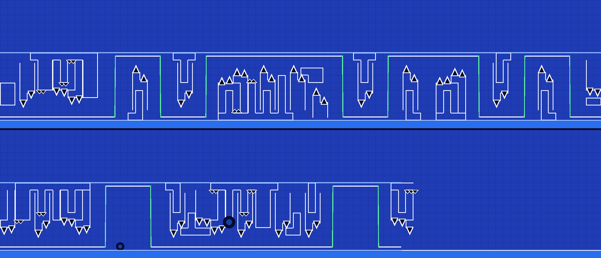
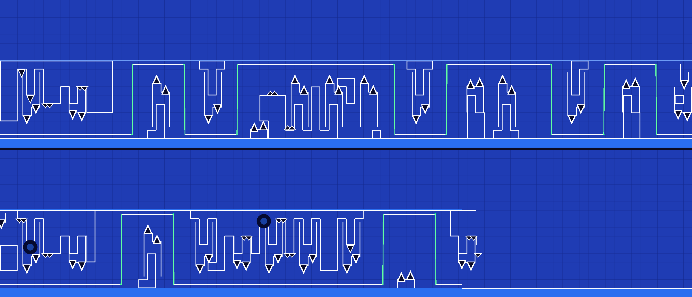
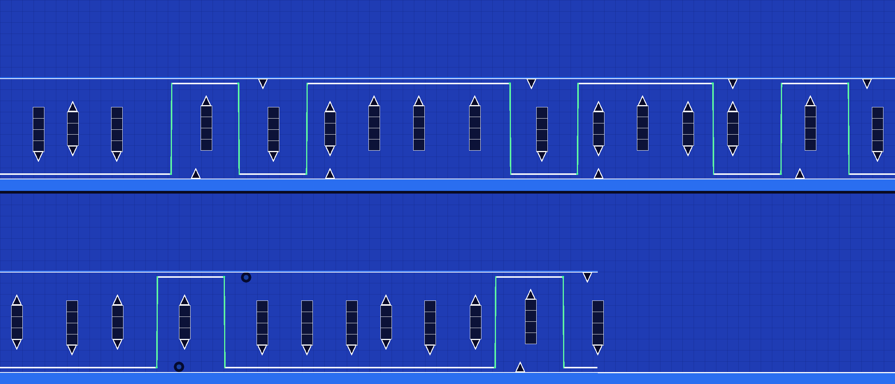
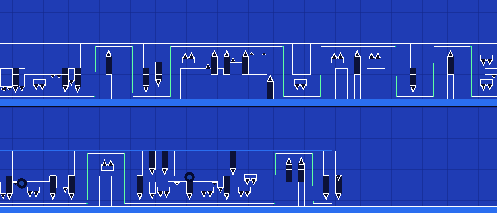

# Preview gallery

Generated by `tools/make_gallery.sh` with the core renderer, drawn like the editor. The bot's path
is white (green while the button is held). Every image is the same song and seed with a different
structure style.

## Rail

## Slope

## Compact

## Spiky

