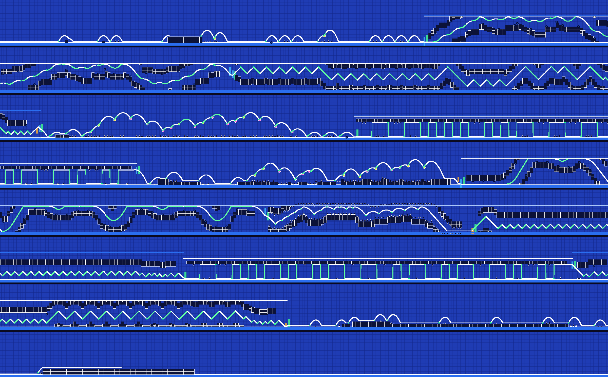
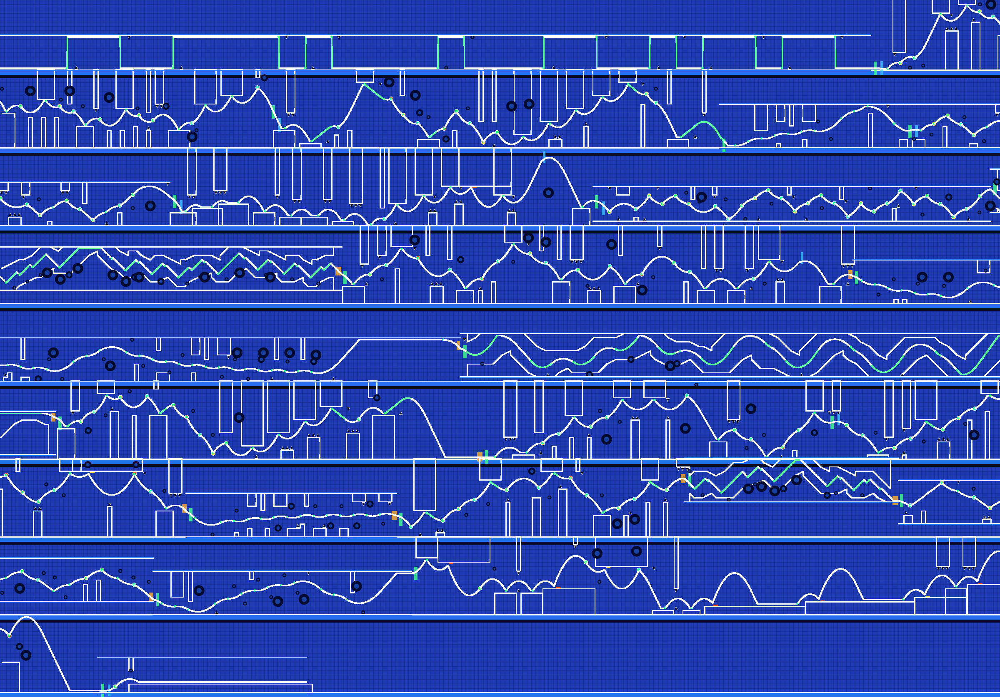

# Preview gallery

Generated by `tools/make_gallery.sh` with the core renderer, drawn like the editor: outline
structures in white, spikes, saws, orbs and pads in their colours, portals as bars (gamemode green,
speed orange, gravity/size blue), the floor and ceiling of flying stretches. The bot's path is
white (green while the button is held). Each image is the whole level, wrapped into rows.

## Demo song, Insane, automatic (all gamemodes)

`alcli generate demo --variant-seed 7 --difficulty 4`

```
BEATABLE (bot verified) | 309 clicks (243 forced, 4 dropped) | windows: min 100 ms, mean 214 ms
longest gap without input: 2.34 s at 43.4 s | music alignment 94% | difficulty follows music: r = 0.67
```


## Demo song, Easy

`alcli generate demo --variant-seed 3 --difficulty 0`

```
BEATABLE (bot verified) | 141 clicks (104 forced, 1 dropped) | windows: min 92 ms, mean 405 ms
longest gap without input: 4.22 s at 127.3 s | music alignment 98% | difficulty follows music: r = 0.55
```


## Demo song, Extreme Demon

`alcli generate demo --variant-seed 5 --difficulty 9`

```
BEATABLE (bot verified) | 477 clicks (452 forced, 1 dropped) | windows: min 54 ms, mean 99 ms
longest gap without input: 1.19 s at 0.0 s | music alignment 82% | difficulty follows music: r = 0.75
```


## Demo song, Harder, Retro style, cube only

`alcli generate demo --variant-seed 11 --difficulty 3 --style 5 --modes 0`

```
BEATABLE (bot verified) | 219 clicks (191 forced, 0 dropped) | windows: min 108 ms, mean 201 ms
longest gap without input: 2.34 s at 43.8 s | music alignment 96% | difficulty follows music: r = 0.74
```


## Demo song, Insane, Flow style

`alcli generate demo --variant-seed 2 --difficulty 4 --style 1`

```
BEATABLE (bot verified) | 297 clicks (248 forced, 4 dropped) | windows: min 92 ms, mean 210 ms
longest gap without input: 2.34 s at 43.4 s | music alignment 95% | difficulty follows music: r = 0.69
```


## Demo song, Insane, classic builder (v1) for comparison

`alcli generate demo --variant-seed 7 --difficulty 4 --engine 1`

```
BEATABLE (bot verified) | 307 clicks (256 forced, 6 dropped) | windows: min 117 ms, mean 233 ms
longest gap without input: 2.80 s at 74.3 s | music alignment 92% | difficulty follows music: r = 0.63
```



## Demo song, Easy Demon, few gamemode switches

`alcli generate demo --variant-seed 9 --difficulty 5 --switch 0.15`

```
BEATABLE (bot verified) | 351 clicks (290 forced, 1 dropped) | windows: min 88 ms, mean 187 ms
longest gap without input: 2.34 s at 88.4 s | music alignment 92% | difficulty follows music: r = 0.78
```



## Demo song, built around the demo click recording (faithfulness 0.9)

`alcli generate demo --variant-seed 4 --difficulty 4 --recording demo --faith 0.9`

```
recording: 276 clicks: 100% on the music (mean offset 9 ms, your latency +23 ms removed), 8 holds, 15 doubles, 2 streams, 3 motifs
BEATABLE (bot verified) | 276 clicks (193 forced, 1 dropped) | windows: min 79 ms, mean 220 ms
longest gap without input: 7.75 s at 0.0 s | music alignment 77% | difficulty follows music: r = 0.69
```


## Random synthetic song #17, Medium Demon

`alcli generate random:17 --variant-seed 17 --difficulty 6`

```
BEATABLE (bot verified) | 260 clicks (193 forced, 0 dropped) | windows: min 100 ms, mean 166 ms
longest gap without input: 1.71 s at 48.1 s | music alignment 92% | difficulty follows music: r = 0.80
```


## Random synthetic song #23, Hard, flying modes only

`alcli generate random:23 --variant-seed 23 --difficulty 2 --modes 1,3,4,7`

```
BEATABLE (bot verified) | 380 clicks (288 forced, 0 dropped) | windows: min 133 ms, mean 301 ms
longest gap without input: 3.19 s at 7.8 s | music alignment 100% | difficulty follows music: r = 0.71
```


