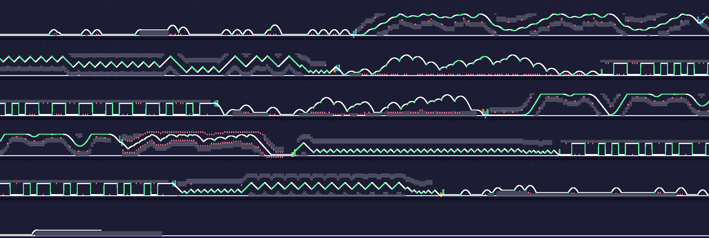
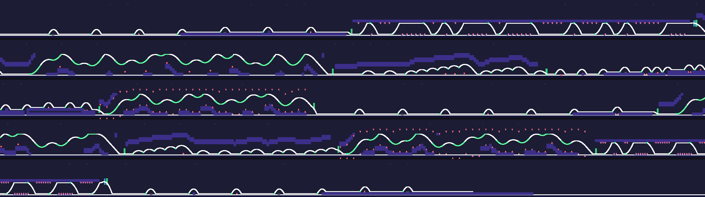
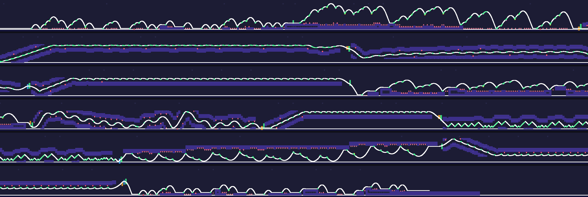
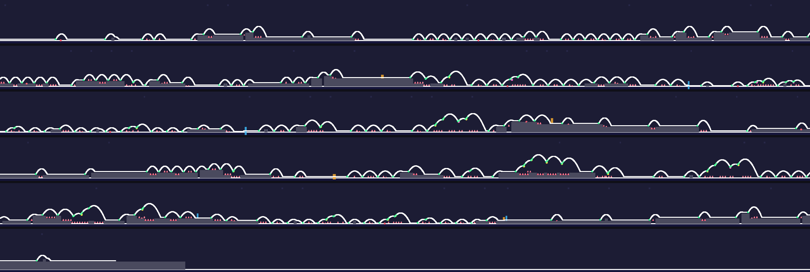
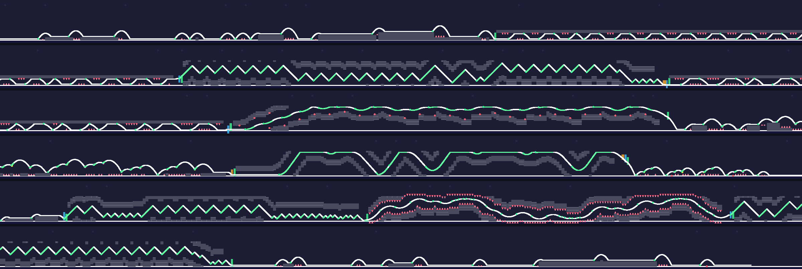
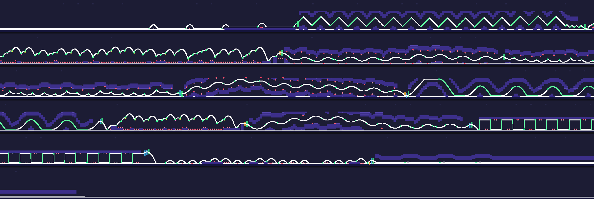
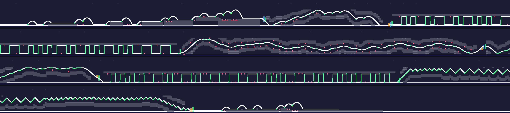
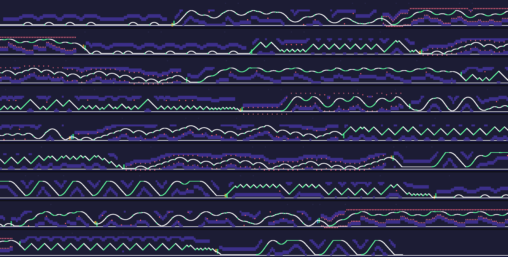

# Preview gallery

Generated by `tools/make_gallery.sh` with the core renderer: blocks grey, hazards red, orbs
yellow/pink, portals green/blue/orange, the bot's path white (green while the button is held),
click markers green. Each image is the whole level, wrapped into rows.

## Demo song, Insane, automatic (all gamemodes)

`alcli generate demo --variant-seed 7 --difficulty 4`

```
BEATABLE (bot verified) | 307 clicks (256 forced, 6 dropped) | windows: min 117 ms, mean 233 ms
longest gap without input: 2.80 s at 74.3 s | music alignment 92% | difficulty follows music: r = 0.63
```



## Demo song, Easy

`alcli generate demo --variant-seed 3 --difficulty 0`

```
BEATABLE (bot verified) | 129 clicks (93 forced, 0 dropped) | windows: min 208 ms, mean 294 ms
longest gap without input: 3.30 s at 28.8 s | music alignment 98% | difficulty follows music: r = 0.56
```



## Demo song, Extreme Demon

`alcli generate demo --variant-seed 5 --difficulty 9`

```
BEATABLE (bot verified) | 454 clicks (280 forced, 23 dropped) | windows: min 50 ms, mean 206 ms
longest gap without input: 1.65 s at 0.0 s | music alignment 77% | difficulty follows music: r = 0.40
```



## Demo song, Harder, Retro style, cube only

`alcli generate demo --variant-seed 11 --difficulty 3 --style 5 --modes 0`

```
BEATABLE (bot verified) | 218 clicks (201 forced, 17 dropped) | windows: min 129 ms, mean 194 ms
longest gap without input: 2.81 s at 43.4 s | music alignment 97% | difficulty follows music: r = 0.67
```



## Demo song, Insane, Flow style

`alcli generate demo --variant-seed 2 --difficulty 4 --style 1`

```
BEATABLE (bot verified) | 294 clicks (240 forced, 7 dropped) | windows: min 121 ms, mean 232 ms
longest gap without input: 2.80 s at 74.3 s | music alignment 92% | difficulty follows music: r = 0.63
```



## Demo song, built around the demo click recording (faithfulness 0.9)

`alcli generate demo --variant-seed 4 --difficulty 4 --recording demo --faith 0.9`

```
recording: 276 clicks: 100% on the music (mean offset 9 ms, your latency +23 ms removed), 8 holds, 15 doubles, 2 streams, 3 motifs
BEATABLE (bot verified) | 272 clicks (204 forced, 37 dropped) | windows: min 112 ms, mean 230 ms
longest gap without input: 7.75 s at 0.0 s | music alignment 84% | difficulty follows music: r = 0.67
```



## Random synthetic song #17, Medium Demon

`alcli generate random:17 --variant-seed 17 --difficulty 6`

```
BEATABLE (bot verified) | 239 clicks (165 forced, 2 dropped) | windows: min 83 ms, mean 226 ms
longest gap without input: 2.09 s at 11.2 s | music alignment 93% | difficulty follows music: r = 0.69
```



## Random synthetic song #23, Hard, flying modes only

`alcli generate random:23 --variant-seed 23 --difficulty 2 --modes 1,3,4,7`

```
BEATABLE (bot verified) | 364 clicks (236 forced, 9 dropped) | windows: min 171 ms, mean 283 ms
longest gap without input: 2.87 s at 152.7 s | music alignment 99% | difficulty follows music: r = 0.70
```



